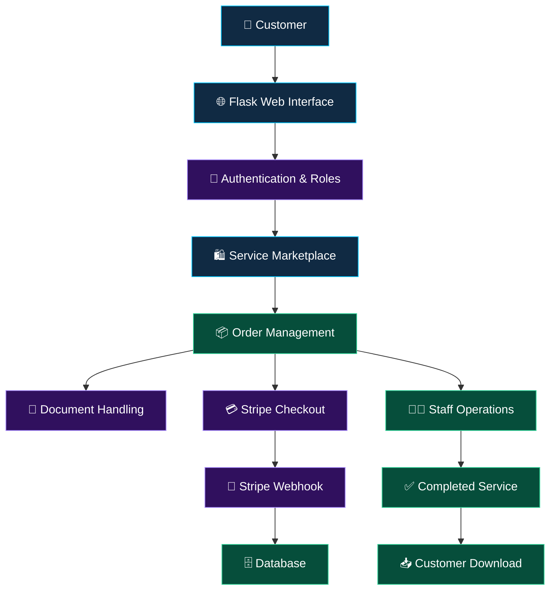

# 🌐 JOHN ONLINE SERVICES & APPLICATIONS

<div align="center">


<br/>


<br/>


### 🚀 Your Gateway to Smarter Digital Services

*Connecting people, simplifying applications, and transforming everyday digital processes into seamless online experiences.*

[Explore Features](#-core-features) • [Technology](#-technology-stack) • [Installation](#-getting-started) • [Security](#-security--production-readiness)

</div>

---

## ⚡ About the Project

**JOHN ONLINE SERVICES & APPLICATIONS** is a Flask-based digital service marketplace designed to make online services more accessible, organized, and convenient.

The platform provides a structured workflow where customers can discover services, submit requests, upload required documents, make online payments, track progress, and download completed work.

Behind the interface is a role-based management system designed to support service delivery, administration, financial operations, and customer interactions.

```text
╔════════════════════════════════════════════════════╗
║          JOHN ONLINE SERVICES & APPLICATIONS       ║
╠════════════════════════════════════════════════════╣
║  DISCOVER  →  REQUEST  →  UPLOAD  →  PAY           ║
║       →  TRACK  →  COMPLETE  →  DOWNLOAD           ║
╚════════════════════════════════════════════════════╝
```

<div align="center">


</div>

## ✨ Core Features

<table>
<tr>
<td width="50%">

### 🛍️ Digital Marketplace

Discover available digital services through an organized service catalog.

- Service listings
- Customer order creation
- Structured request workflows
- Order reference numbers

</td>
<td width="50%">

### 📂 Secure Document Handling

A document upload workflow for customer service requests.

- File upload support
- Private local file storage
- Controlled access design
- Completed-work downloads

</td>
</tr>
<tr>
<td width="50%">

### 💳 Online Payments

Stripe integration for supported payment workflows.

- Stripe Checkout
- Payment webhook endpoint
- Minimum TZS checkout validation
- Payment status processing

</td>
<td width="50%">

### 📊 Order Tracking

A centralized workflow for following customer requests.

- Order status management
- Progress visibility
- Service delivery workflow
- Order history foundations

</td>
</tr>
<tr>
<td width="50%">

### 👥 Role-Based Access

Designed around different operational responsibilities.

- Super administrator
- Administrator
- Service officer
- Accountant
- Customer

</td>
<td width="50%">

### 🗄️ Database Management

Database tooling designed to support structured application data.

- Flask-SQLAlchemy
- Flask-Migrate
- SQLite development database
- Schema migration workflow

</td>
</tr>
</table>

## 🎭 Animated Technology Showcase

<div align="center">


<br/><br/>


</div>

> The activity graph displays GitHub account activity when available; it is not a live application analytics dashboard.

## 🧰 Technology Stack

| Layer | Technology | Purpose |
|---|---|---|
| Language | Python 3.12+ | Application logic |
| Backend | Flask | Web application framework |
| ORM | Flask-SQLAlchemy | Database models and queries |
| Migrations | Flask-Migrate | Database schema evolution |
| Authentication | Flask-Login | User session management |
| Forms | Flask-WTF | Form handling and CSRF protection |
| Templates | Jinja2 | Server-rendered pages |
| Styling | Tailwind CSS CDN | Rapid interface styling |
| Interactivity | Alpine.js | Lightweight frontend interactions |
| Payments | Stripe | Checkout and payment webhooks |
| Development DB | SQLite | Local development |
| File storage | Local private storage | Uploaded documents |

## 🏗️ Application Architecture



## 👑 User Roles

| Role | Intended responsibility |
|---|---|
| `super_admin` | Highest-level platform administration |
| `admin` | Operational and service management |
| `service_officer` | Handling customer requests and service delivery |
| `accountant` | Financial operations and payment oversight |
| `customer` | Requesting services and accessing permitted order information |

Actual permissions should be enforced on the server for every protected action.

## 💳 Stripe Payment Integration

The application provides Stripe Checkout and webhook routes for supported payment workflows.

```http
POST /orders/<order_number>/stripe-checkout
POST /stripe/webhook
```

### 🇹🇿 Tanzania Shilling Support

The application includes a configurable minimum checkout amount for TZS payments.

```env
STRIPE_MIN_TZS=1500
```

Orders below the configured minimum are blocked before checkout and can display a user-friendly validation message.

**Important:** The minimum is an application setting, not a guarantee that every currency and Stripe account configuration supports the transaction. Confirm the current Stripe payment-method and currency requirements before production use.

## 🚀 Getting Started

### 1. Prerequisites

Install:

- Python 3.12 or newer
- Git
- A Stripe account for payment integration testing

### 2. Clone the Repository

```powershell
git clone https://github.com/johncharlessarwi-dot/REPOSITORY-NAME.git
cd REPOSITORY-NAME
```

Replace `REPOSITORY-NAME` with the actual repository name.

### 3. Create a Virtual Environment

```powershell
python -m venv .venv
.\.venv\Scripts\Activate.ps1
```

If PowerShell blocks environment activation, configure an appropriate execution policy for your environment or activate the virtual environment using another supported shell.

### 4. Install Dependencies

```powershell
pip install -r requirements.txt
```

### 5. Configure Environment Variables

```powershell
Copy-Item .env.example .env
```

Edit `.env` and configure the required values according to the application's settings.

Example configuration:

```env
SECRET_KEY=replace-with-a-long-random-secret
DATABASE_URL=sqlite:///app.db

STRIPE_SECRET_KEY=sk_test_replace_me
STRIPE_WEBHOOK_SECRET=whsec_replace_me
STRIPE_MIN_TZS=1500
```

These variable names are examples; verify that they match the names expected by your application code. Never commit real credentials or production secrets.

### 6. Initialize the Database

```powershell
flask db init
flask db migrate -m "Initial schema"
flask db upgrade
```

**For a fresh project:** run `flask db init` only if the migrations directory does not already exist. Review generated migrations before applying them.

### 7. Seed Initial Data

```powershell
flask seed-data
```

### 8. Create an Administrator

```powershell
flask create-admin --name "Super Admin" --email admin@example.com --password "REPLACE_WITH_A_STRONG_PASSWORD"
```

Use a unique password and avoid exposing credentials in shell history or screenshots. Confirm the CLI command's password handling before using it.

### 9. Launch the Development Server

```powershell
flask run
```

Open the application at:

**http://localhost:5000**

## 🔐 Security & Production Readiness

Security is a core part of building a reliable digital marketplace.

- **Secret management:** Store production secrets in environment variables or a dedicated secrets manager.
- **Authentication:** Protect private routes with authentication and enforce role permissions on the server.
- **CSRF protection:** Enable and validate CSRF protection for state-changing form submissions.
- **File uploads:** Validate file extensions, actual file types, file sizes, and permitted upload destinations.
- **Private downloads:** Authorize every document download against the relevant customer and order.
- **Stripe webhooks:** Verify webhook signatures and process events idempotently.
- **Payments:** Validate order amounts server-side and reconcile payment status using verified provider events.
- **Database:** Use managed or production-grade database infrastructure when scaling beyond a single development server.
- **HTTPS:** Enforce secure transport and configure secure session cookies.
- **Monitoring:** Add structured logs, error monitoring, backups, and operational alerts.
- **Rate limiting:** Protect authentication, checkout, upload, and other sensitive endpoints.
- **Dependency management:** Pin and periodically update dependencies.

### Production deployment checklist

- [ ] Configure a strong, unique `SECRET_KEY`.
- [ ] Replace test payment credentials with approved live credentials only when ready.
- [ ] Configure the production database and apply reviewed migrations.
- [ ] Store customer uploads outside public static directories.
- [ ] Verify authorization for all customer and staff operations.
- [ ] Test payment success, cancellation, failure, and webhook retries.
- [ ] Configure HTTPS and secure cookies.
- [ ] Replace the Tailwind CDN with a compiled build if strict Content Security Policy is required.
- [ ] Configure backups and test restoration.
- [ ] Run security and dependency checks before release.

## 🎨 Design Philosophy

The project aims to deliver a modern, organized, and trustworthy digital service experience.

- 🌌 **Modern UI:** Clean layouts and responsive components.
- ⚡ **Efficiency:** A structured journey from request to delivery.
- 🔒 **Security-conscious design:** Privacy and access control are essential.
- 📱 **Accessibility:** Design for convenient use across screen sizes.
- 🧩 **Maintainability:** Organized application components and database migrations.
- 🇹🇿 **Local relevance:** A service marketplace intended to support digital-service needs in Tanzania.

## 🗺️ Project Roadmap

The following roadmap describes potential improvements; it does not claim that unimplemented features are already available.

- [ ] Responsive customer dashboard enhancements
- [ ] Advanced order status timeline
- [ ] Email and SMS notifications
- [ ] Improved administrative analytics
- [ ] Automated payment reconciliation
- [ ] Cloud-based private document storage
- [ ] Audit trails for administrative actions
- [ ] Automated tests and continuous integration
- [ ] Production deployment automation
- [ ] Swahili and English language support
- [ ] Customer feedback and service ratings
- [ ] Advanced reporting and financial summaries

## 📈 GitHub Developer Showcase

<div align="center">


<br/>


<br/>


</div>

*GitHub statistics, trophies, and contribution graphs depend on the availability of the relevant public services and account data.*

## 🤝 Contributing

Contributions, ideas, and improvements are welcome.

1. Fork the repository.
2. Create a feature branch.
3. Make your changes.
4. Test your implementation.
5. Submit a pull request describing your improvements.

```bash
git checkout -b feature/your-feature
git add .
git commit -m "feat: add your feature"
git push origin feature/your-feature
```

## 📜 License

Add the appropriate license for this repository before distributing the software. Until a license is selected and included, do not assume that others have permission to reuse or redistribute the code.

## 👨‍💻 Created By

<div align="center">


### JOHN ONLINE SERVICES & APPLICATIONS

**Innovation. Technology. Opportunity.**

*Building practical digital solutions that simplify services and empower people.*

[](https://github.com/johncharlessarwi-dot)

<br/>


**THANK YOU FOR VISITING! 🚀**

*Designed and developed by JOHN ONLINE SERVICES & APPLICATIONS.*

</div>
